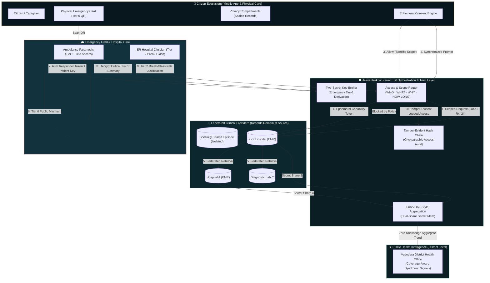
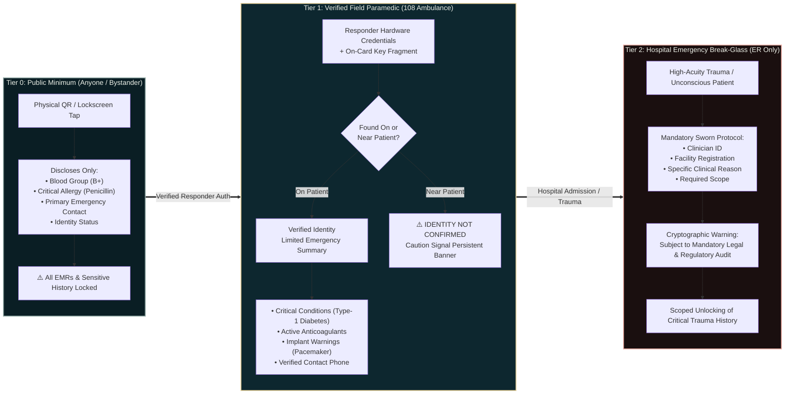
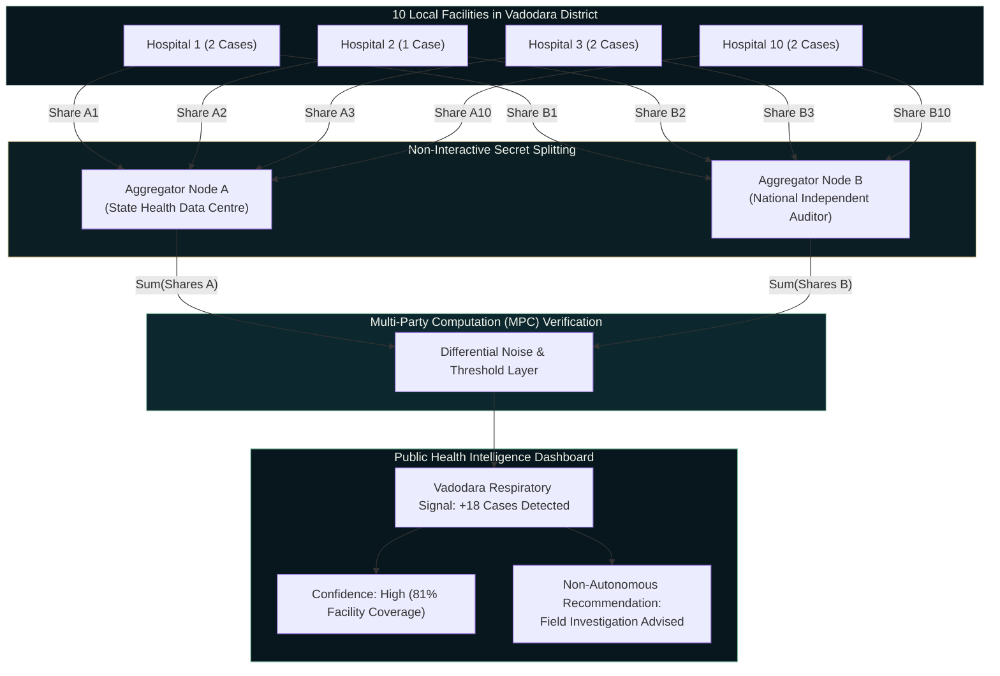
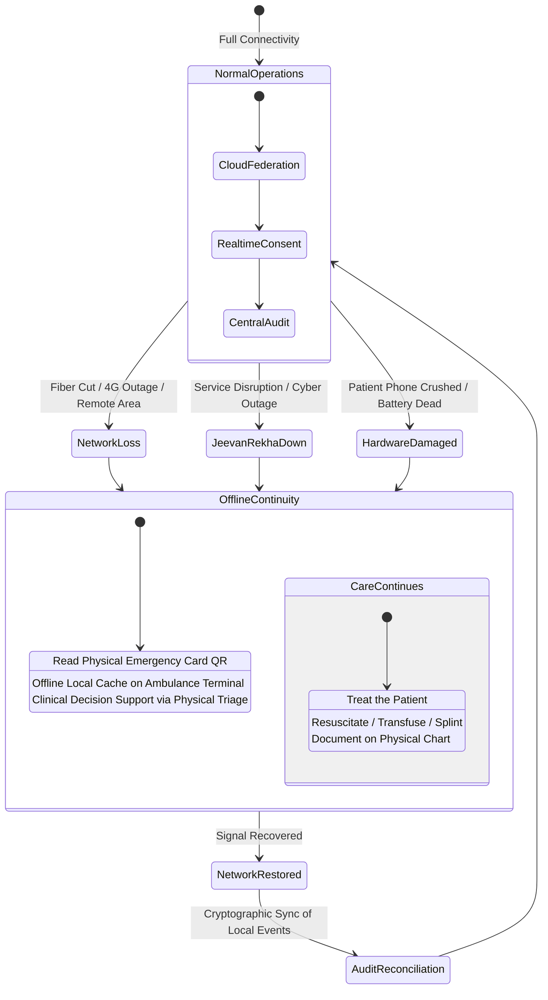

# 🏥 JeevanRekha (जीवनरेखा)
### *Zero-Trust Health Data, Consent & Emergency Access Intelligence Layer for India*

[](https://jeevanrekha-delta.vercel.app)
[](https://jeevanrekha-delta.vercel.app/prototype)
[](https://jeevanrekha-delta.vercel.app/architecture)
[](https://github.com/rudrakhairnar16-bit/jeevanrekha)
[](https://nextjs.org)
[](https://www.w3.org/WAI/standards-guidelines/wcag/)

> **"Right Person. Right Data. Right Reason. Right Time. And never more than necessary."**  
> **"Care is NEVER denied because JeevanRekha failed."**

---

## 🌐 Quick Access Links

| Experience Surface | Target URL | Description |
| :--- | :--- | :--- |
| 🎬 **Cinematic 3D Narrative** | [jeevanrekha-delta.vercel.app](https://jeevanrekha-delta.vercel.app) | Real-time WebGL film telling the story of an incident in Vadodara to hospital consent and care continuity. |
| 🧪 **Full Product Prototype** | [jeevanrekha-delta.vercel.app/prototype](https://jeevanrekha-delta.vercel.app/prototype) | Believable, multi-role digital health ecosystem connecting Citizen, Doctor, Responder, and Public Health. |
| 🏛️ **Architecture & Labs** | [jeevanrekha-delta.vercel.app/architecture](https://jeevanrekha-delta.vercel.app/architecture) | Deep-dive explainer with interactive attack simulation, secret sharing, and resilience labs. |
| 🔍 **System Audit & Specs** | [jeevanrekha-delta.vercel.app/status](https://jeevanrekha-delta.vercel.app/status) | Engineering metrics, accessibility guarantees, and test verification logs. |

---

## 📌 Executive Summary & Problem Statement

India's digital healthcare expansion faces a fundamental architectural dilemma:
1. **The Fragmented Silo Problem:** Critical patient medical history is scattered across disparate paper records, private nursing homes, public hospital EMRs, and diagnostic labs, rendering emergency and routine clinical handoffs dangerously blind.
2. **The Centralized Honeypot Trap:** Creating a massive, single national repository storing 1.4 billion citizens' medical histories introduces catastrophic surveillance, single-point-of-failure vulnerabilities, and unacceptable breach risks.

### The JeevanRekha Architectural Solution
JeevanRekha is **NOT a central medical database**. It does not store medical records, consultations, or diagnostic scans. 

Instead, JeevanRekha is a **decentralized zero-trust orchestration, consent, emergency continuity, and privacy-preserving public health intelligence layer** built around India's existing ABDM / ABHA digital health foundations:
- **Federated Source Storage:** Clinical records remain encrypted at their point of origin (Hospital A, Lab C, Nursing Home B).
- **Zero-Trust Access Gate:** Clinicians and responders receive only ephemeral, cryptographically authorized access for specific clinical reasons and bounded time windows.
- **Fail-Safe Offline Continuity:** In real-world Indian conditions (network dead zones, server outages, device loss), **CARE CONTINUES** using fail-open local protocols.

---

## 🏛️ System Architecture



---

## ⚡ Key Interactive Flows

### 1. Consent-Controlled Clinical Federation

```mermaid
sequenceDiagram
    autonumber
    actor Doctor as 👨‍⚕️ Dr. Sharma (XYZ Hospital)
    participant JR as 🛡️ JeevanRekha Trust Engine
    actor Citizen as 📱 Rahul (Citizen App)
    participant Sources as 🏥 Distributed Hospitals (A & C)
    participant Audit as 📜 Cryptographic Audit Ledger

    Doctor->>JR: Confirm Patient Identity (Aadhaar / ABHA Match)
    Note over Doctor,JR: Identity Confirmed ≠ Permission Granted! History remains locked.
    Doctor->>JR: Create Request: Labs + Prescriptions (Purpose: Routine Visit, Duration: 2 Hours)
    JR->>Citizen: Push Notification: WHO / WHAT / WHY / HOW LONG
    Citizen->>JR: Explicit Decision: ALLOW (Scoped)
    JR->>Doctor: Issue Ephemeral Scoped Token (Expires in 120m)
    Doctor->>Sources: Query Federated Records with Token
    Sources-->>Doctor: Return Blood Counts (Hospital A) & Chest X-Ray (Lab C)
    Note over Doctor,Sources: Psychiatric consultation remains locked in Sealed Compartment.
    JR->>Audit: Append Tamper-Evident Access Event
    
    rect rgb(20, 45, 55)
        Note over Citizen,Doctor: Real-Time Revocation Test
        Citizen->>JR: User taps "Revoke Access"
        JR->>Doctor: Immediately Invalidate Session Key
        Doctor-->>Doctor: Access Revoked: Records vanish instantly
        JR->>Audit: Log Immediate Revocation Event
    end
```


---

### 2. Tiered Emergency Access Continuum (Tier 0 $\rightarrow$ Tier 1 $\rightarrow$ Tier 2)



---

### 3. Dual-Path Privacy-Preserving Syndromic Aggregation

Traditional public-health reporting suppresses counts under five (`<5`), creating blind spots where 10 hospitals each reporting 2 cases appear as 0 cases in the district capital. JeevanRekha illustrates a **Prio / VDAF cryptographic direction**:



---

### 4. Resilience & The "Care Continues" Failure Protocol



---

## 📱 The 10-Role Interactive Prototype Ecosystem

The interactive prototype at [`/prototype`](https://jeevanrekha-delta.vercel.app/prototype) allows judges and evaluators to live-test all 10 roles in real-time synchronized state:

| # | Role / Space | Key Interactive Capabilities | Constitutional Guardrail |
| :---: | :--- | :--- | :--- |
| **01** | **Citizen (Today)** | Daily health overview, medication reminders, upcoming appointments, pending consent requests, and emergency card readiness status. | Minimal cognitive load; no clinical jargon. |
| **02** | **Citizen (My Health)** | Longitudinal timeline with verified clinical provenance badges (Verified Clinical, Verified Lab, Patient Reported). Expand records to compare immutable version history. | Original clinical records are never silently overwritten. |
| **03** | **Citizen (Consent)** | Live consent inbox showing **WHO / WHAT / WHY / HOW LONG**. Interactive Allow and immediate live Revocation that updates Doctor view in real time. | Explicit granular category selection; no dark patterns. |
| **04** | **Citizen (Emergency Card)** | 3-state emergency field privacy toggle (`PUBLIC`, `RESPONDERS ONLY`, `DON'T SHOW`) with an instant **"What Strangers Can See"** preview. | Sensitive fields default to protected; never public by default. |
| **05** | **Doctor Portal** | Demographic patient matching with explicit confirmation. Granular Request Builder (duration, purpose, category selection). Authorized federated records view with live countdown timer. | Identity match $\neq$ Permission. Unconsented categories remain strictly locked. |
| **06** | **Emergency Responder** | High-contrast, single-hand interface. Simulated camera/NFC scanner. **"Found On" vs "Found Near Patient"** toggle (auto-triggers persistent "IDENTITY NOT CONFIRMED" warning). Simulated offline mode. | Digital systems never delay resuscitation. **Care Continues**. |
| **07** | **Family / Caregiver** | Capability-based sharing (medication reminders, appointments). Privacy-preserving notifications ("Medication missed" without leaking diagnoses). Family capability request workflow. | Family relationship $\neq$ Complete medical history. |
| **08** | **Public Health** | Vadodara syndromic surveillance graph. Interactive reporting coverage slider (81% $\rightarrow$ 62% $\rightarrow$ 40%) demonstrating how confidence dynamically responds to missing facilities. | Population signals only; zero patient row leaks. |
| **09** | **Security & Audit Console** | Full cryptographic audit trail. Heuristic anomaly warnings with restrained posture (**"REVIEW RECOMMENDED"**). Interactive **"Simulate Historical Tampering"** demonstrating instant **"MISMATCH DETECTED"**. | System never falsely proclaims absolute infallibility. |
| **10** | **Guided Jury Mode** | Comprehensive 20-step guided presentation bar with "WHY THIS MATTERS" constitutional explanations and auto-configured state transitions. | Real interactive product surfaces remain fully accessible during demo. |

---

## 🛡️ Constitutional Guarantees & Threat Model

| Threat Scenario | Vulnerability in Legacy Architecture | JeevanRekha Defense Invariant | Verified Prototype Result |
| :--- | :--- | :--- | :--- |
| **Central Database Breach** | Attacker compromises central server, exfiltrating 1.4B medical histories. | **Zero Central EMR Storage.** JeevanRekha only stores consent tokens and cryptographic proofs. | Compromised central node yields no medical diagnoses or clinical scans. |
| **Stolen / Photographed QR Code** | QR contains encoded JSON with full medical history and home address. | **Tiered Access Separation.** Physical QR contains only Tier-0 minimum and public key component. | Stranger sees only blood group, critical allergy, and emergency contact. |
| **Compromised Responder Credential** | Stolen paramedic badge enables bulk harvesting of patient histories. | **Two-Secret Decryption Requirement.** Paramedic badge must be physically paired with patient's on-card secret. | Rogue badge without physical patient interaction cannot decrypt Tier-1 summary. |
| **Intrafamily Surveillance** | Elder abuse or domestic surveillance via caregiver account. | **Capability-Based Authorization.** Caregivers receive action items (e.g. reminder) without clinical notes. | Notification says "Dose missed" without revealing medication name or psychiatric episode. |
| **Total Telecom Network Blackout** | Cloud-dependent systems freeze; emergency room is locked out of care. | **Non-Blocking Continuity.** Offline cache + physical fallback charts. | **CARE CONTINUES.** Medical staff proceed with human resuscitation protocols. |

---

## 💻 Tech Stack & Engineering Standards

- **Core Framework:** [Next.js 16.4.2](https://nextjs.org) with Turbopack bundler.
- **UI Architecture:** [React 19](https://react.dev) with React Server Components (RSC) and custom React Context state synchronization.
- **3D Cinematic Engine:** [Three.js 0.186.1](https://threejs.org) on a single WebGL canvas driven by deterministic native window scroll (zero wheel-hijacking, zero layout jumps).
- **Type Safety:** 100% Strict [TypeScript 5](https://www.typescriptlang.org) (`tsc --noEmit` cleanly passing with 0 errors).
- **Styling Grammar:** Custom, restrained design system (`prototype.css` & `cinematic-rescue.css`):
  - *Deep Navy (`#07171d`)*: Trust, authority, and protection.
  - *Warm Ivory (`#f7f5ed`)*: Human care and clinical warmth.
  - *Restrained Teal (`#a9d4bd`)*: Authorized verification and active consent.
  - *Muted Grey (`#8fa6a2`)*: Unavailable or locked compartments.
  - *Warning Coral (`#efb3aa`)*: High-acuity critical conditions and tamper alerts only.
- **Accessibility & Inclusivity:** 
  - Complete server-rendered static reading mode for no-JavaScript environments.
  - High-contrast mode support and system `prefers-reduced-motion` compliance.
  - Responsive reflow verified from 320px mobile screens to 1440px+ 4K monitors.

---

## 🚀 Running Locally

### Prerequisites
- Node.js >= 20.9.0
- npm >= 10.0.0
- Python 3 (for documentation link validation)

### 1. Clone & Install
```bash
git clone https://github.com/rudrakhairnar16-bit/jeevanrekha.git
cd jeevanrekha
npm ci
```

### 2. Start Development Server
```bash
npm run dev
```
Open [http://localhost:3000](http://localhost:3000) to view the 3D cinematic film, or [http://localhost:3000/prototype](http://localhost:3000/prototype) to launch the product ecosystem.

### 3. Verification & Quality Gates
```bash
# 1. Verify TypeScript type safety
npm run typecheck

# 2. Verify Next.js production build and static page prerendering
npm run build

# 3. Verify documentation links and syntax
python tools/check_docs.py

# 4. Run the full Playwright browser test suite (82 tests)
npm run test:e2e --workspace apps/web
```

---

## 🧪 Comprehensive Verification Suite (82/82 PASS)

The codebase has undergone exhaustive automated testing using Playwright Chromium across 82 independent regression checks:

```text
✓ 82/82 Playwright tests passed (100% pass rate)

Suite Breakdown:
  • cinema-chromium: 26 tests (deterministic camera tracks, context loss, GPU buffer release)
  • readable-story: 56 tests (responsive 320px/390px/768px/1440px, keyboard skip, no-JS fallback)
  • consent.spec.ts: Granular category selection, decision synchronisation, and live revocation
  • privacy.spec.ts: Sealed compartment leak protection and metadata isolation
  • closing.spec.ts: Care Continues failure resilience and offline continuity
  • emergency-motion.spec.ts: 3-tier emergency separation and public QR bounds
```

---

## 📚 Comprehensive Documentation Directory

Every architectural claim is backed by peer-reviewed design documents in the [`docs/`](docs/) directory:

- [docs/SYSTEM_E2E.md](docs/SYSTEM_E2E.md): Master canonical requirements baseline.
- [docs/SECURITY.md](docs/SECURITY.md): Threat model, cryptographic assumptions, and production gates.
- [docs/DATA_MODEL.md](docs/DATA_MODEL.md): Entity relationships, ownership boundaries, and state invariants.
- [docs/FLOWS.md](docs/FLOWS.md): Detailed event catalogues, edge cases, and failure recovery flows.
- [docs/DECISIONS.md](docs/DECISIONS.md): 48 Architecture Decision Records (ADRs).
- [docs/API_CONTRACTS.md](docs/API_CONTRACTS.md): Proposed FHIR/ABHA-aligned contract specifications.
- [docs/MVP_SCOPE.md](docs/MVP_SCOPE.md): Prototype inclusion, mock, and boundary disclosure.

---

## ⚖️ Ethical & Legal Disclaimer

*JeevanRekha is a technology, architectural, and design prototype developed for national digital health competitions. It illustrates concepts for decentralized consent, tiered emergency access, and privacy-preserving public health intelligence. It is not an official government service of the Ministry of Health and Family Welfare (MoHFW) or the National Health Authority (NHA). All clinical patient scenarios, medical records, and diagnostic signals demonstrated in the prototype are synthetic and fictional. Production deployment of cryptographic primitives (Prio/VDAF, dual-key recovery) requires independent formal security audit and statutory medical-legal review.*

---

**Project Lead & Architect:** Rudra Khaire  
**License:** MIT  
**Live Application:** [https://jeevanrekha-delta.vercel.app](https://jeevanrekha-delta.vercel.app)
