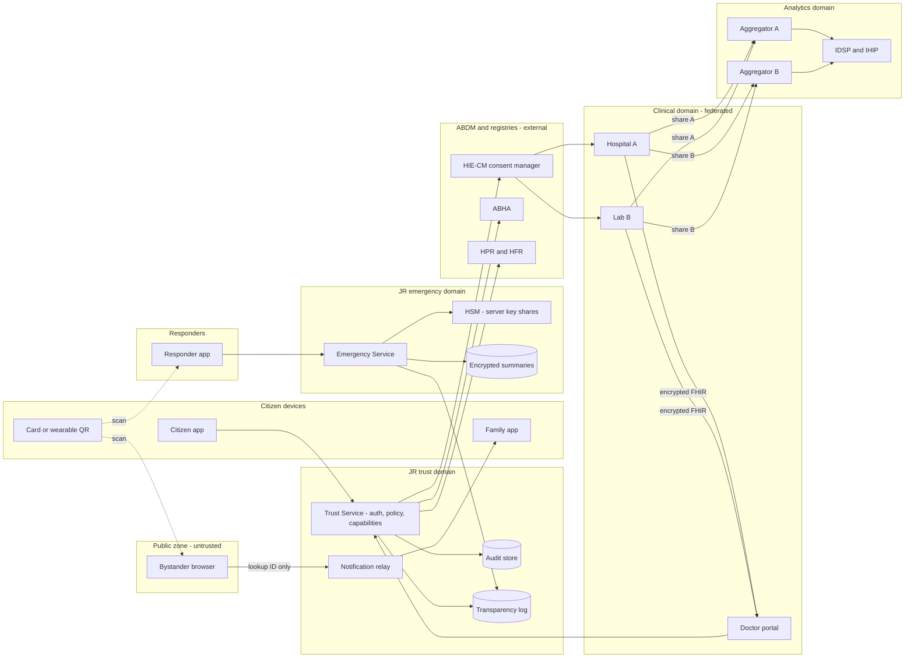
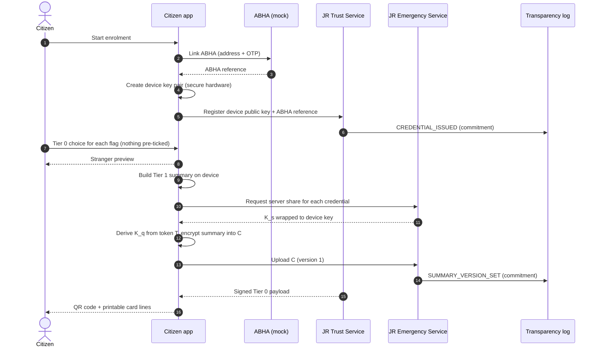
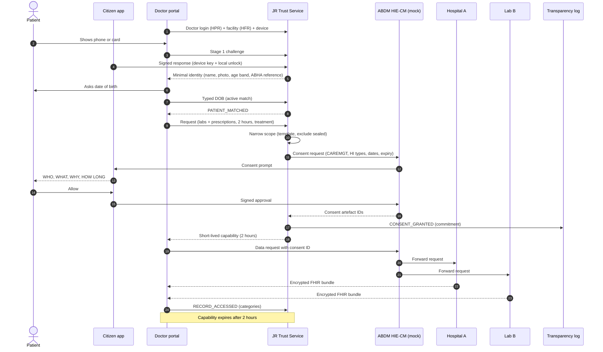
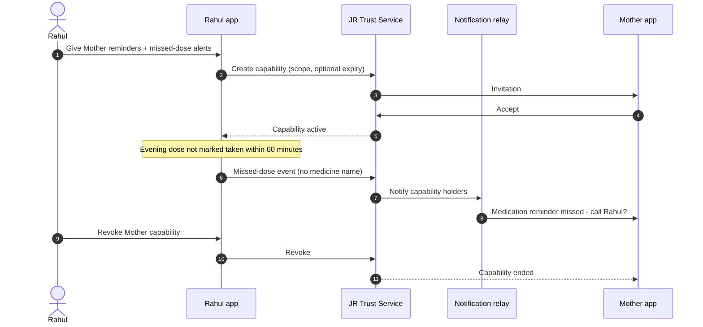
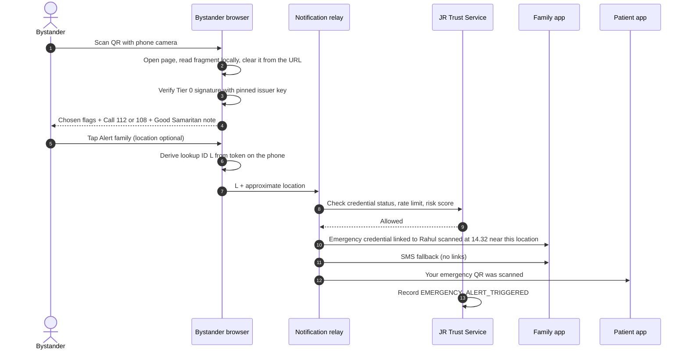
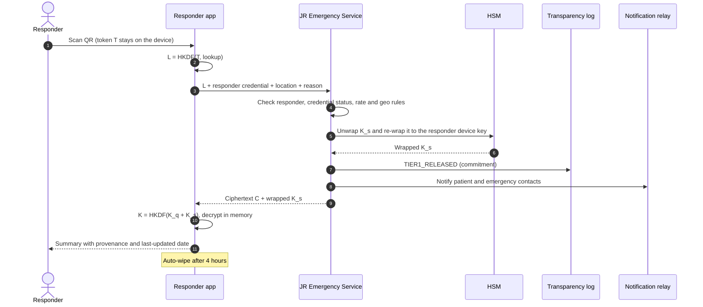
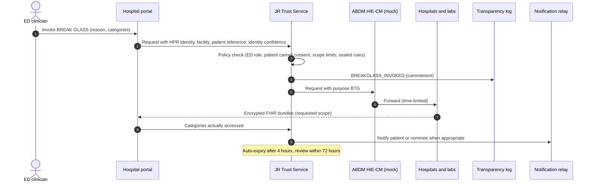
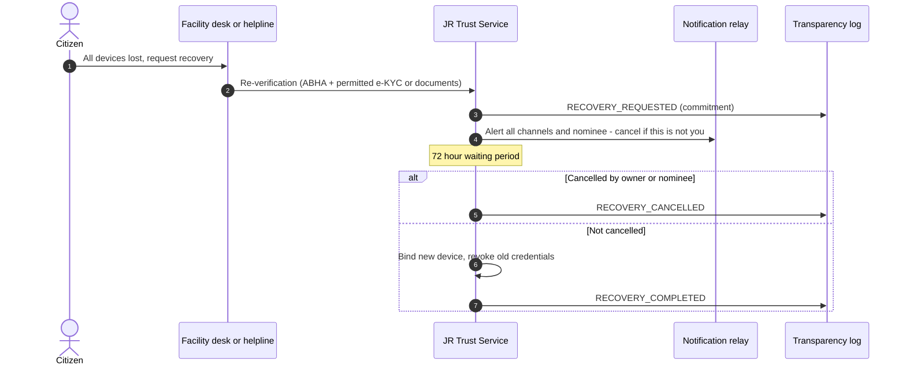
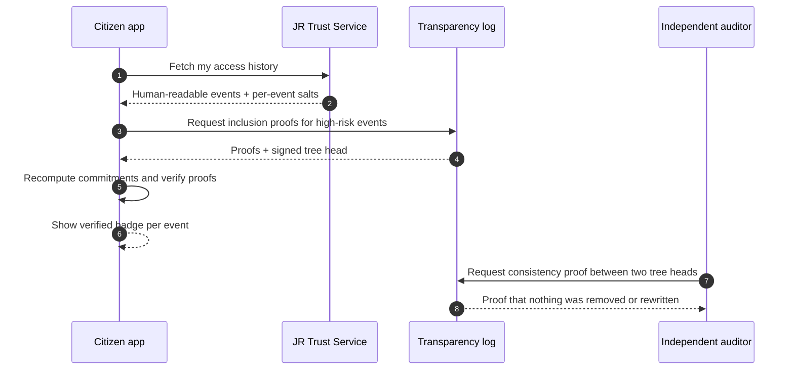
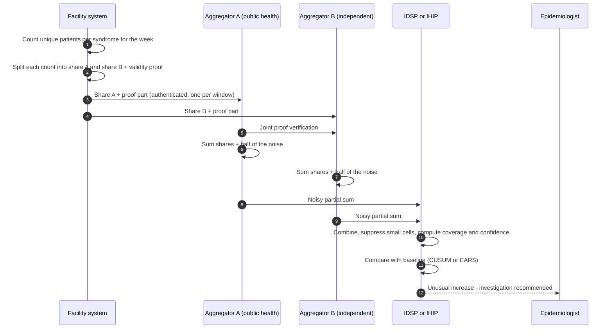

# JeevanRekha — System Flows

> **Living document** · Last updated **2026-10-16** · Owner: **Rudra Khaire**
> Read with: [SYSTEM_E2E.md](SYSTEM_E2E.md) (the *what*) · [DECISIONS.md](DECISIONS.md) (the *why*)
> 25 flows · 9 sequence diagrams · 1 trust-boundary diagram · event catalogue · failure matrix · demo storyline
> Jump to: [Index](#flow-index) · [System context](#context) · [Events](#events) · [Demo storyline](#demo)

---

## 1. What this file is, and why it exists

[DECISIONS.md](DECISIONS.md) records **why** each choice was made. This file shows **how** those choices play out step by step: who talks to whom, in what order, what is checked, what is logged, and what happens when something fails. It is the bridge from architecture to the build.

**What goes into each flow, and why** (research-backed):

| Element | Why it is here | Source |
|---|---|---|
| **Goal, primary actor, trigger, preconditions** | Pins down scope: who wants what, and what must already be true | Cockburn use-case template ([PDF](https://cis.bentley.edu/lwaguespack/CS360_Site/Downloads_files/Use%20Case%20Template%20(Cockburn).pdf)) |
| **Main success scenario (3–9 steps)** | The happy path written as goals, not UI clicks | [Cockburn guide](http://www.binaryphile.com/software-engineering/requirements/use-cases/2026/05/10/cockburn-use-cases-guide.html) |
| **Extensions** | Every failure or alternate path, each ending in *rejoin*, *alternate success* or *failure*. Completeness comes from here | Cockburn |
| **Minimal guarantee / success guarantee** | What we promise *even when things fail* (for JR: care continues, audit is kept) and what is true on success | Cockburn |
| **Sequence diagram** (Mermaid) | Shows interaction order across systems. GitHub renders Mermaid natively in `.md` files (since Feb 2022) | [freeCodeCamp](https://www.freecodecamp.org/news/how-to-add-diagrams-to-github-readme/) |
| **Trust boundaries & data classes** | Threats concentrate where data crosses a trust boundary. A DFD shows external entities, processes, data stores, flows and boundaries, and STRIDE is applied to each | [OWASP threat modeling](https://owasp.github.io/DevSecOpsGuideline/2-Process/2-1-Design/2-1-1-Threat-modeling/) |
| **Events** (audit / transparency) | Each flow states exactly what evidence it leaves ([ADR-033](DECISIONS.md#adr-033), [ADR-034](DECISIONS.md#adr-034)) | JR decision |
| **Prototype scope** | Build, Mock or Doc-only, so the build plan follows directly | JR decision |

> **Rendering note:** the Mermaid blocks render on GitHub. Simple local previewers may show them as code. All diagrams in this file were parse-checked with Mermaid 11.

### Flow template

```text
F-NN — Name
Goal · Primary actor · Trigger · Preconditions · ADRs · Prototype
Main success scenario   numbered steps
Extensions              2a. condition → handling → rejoin / alternate success / failure
Minimal guarantee       promise even on failure
Success guarantee       state after success
Data classes · Boundaries crossed · Events (ᵀ = also written to the transparency log)
```

---

## 2. Actors & components

| Component | Domain | Responsibility | Prototype |
|---|---|---|---|
| Citizen app (+ family view) | Citizen device | Device credential, consent decisions, Tier-0 setup, Tier-1 summary build, history, reminders | **Build** (PWA) |
| Card / wearable / sticker | Citizen | Emergency credential: QR token, signed Tier 0, printed lines; optional chip | **Mock** (printable QR) |
| Bystander browser | Public | Tier-0 web page (signature check, call buttons, alert family) | **Build** (static page) |
| Doctor / hospital portal | Clinical (requesting side) | Patient match, scoped requests, viewing, break-glass | **Build** |
| Responder app | Emergency | Offline Tier-0 verify, identity confidence, Tier-1 request | **Build** |
| JR Trust Service | Trust | Stage-1 auth, policy engine, capabilities, receipts, credential status | **Build** |
| JR Emergency Service + HSM | Emergency | Encrypted summaries, server key shares, release rules | **Build** (software HSM) |
| Notification relay | Trust | Push / SMS (no links), masked calls, rate limits | **Mock** |
| Transparency log | Audit | Append-only Merkle log, inclusion and consistency proofs | **Build** (simple) |
| Security monitor | Audit | Anomaly rules, review queue | **Build** (rules) |
| ABHA · ABDM HIE-CM · HPR · HFR | External | Identity, consent artefacts, professional and facility registries | **Mock** (ABDM-shaped messages) |
| Hospital A · Lab B · Hospital C | Clinical (providers) | Hold records, serve FHIR bundles, compute weekly counts | **Build** (3 small services, synthetic data) |
| Aggregator A · Aggregator B | Analytics | Secure aggregation (shares, proofs, noise) | **Build** (2 processes) |
| IDSP / IHIP | External | Surveillance workflow, epidemiologist review | **Mock** (dashboard) |

---

<a id="context"></a>
## 3. System context & trust boundaries

Each box is a separate security domain. Arrows show data flows, and every arrow that crosses a box boundary is a place to apply STRIDE.



**What never crosses a boundary:** raw biometrics (stay on the device or card) · the QR token T (stays on the scanning device; only the lookup ID L travels) · clinical records into the JR trust domain · per-facility counts to any single aggregator · individual records into the analytics domain.

---

<a id="flow-index"></a>
## 4. Flow index

| ID | Flow | Primary actor | ADRs | Prototype |
|---|---|---|---|---|
| [F-01](#f-01) | Enrolment & credential issuance | Citizen | 001, 003, 026, 027, 029, 035 | Build |
| [F-02](#f-02) | Normal visit: identity → match → scoped consent → federated fetch | Doctor | 006, 007, 012–015 | Build |
| [F-03](#f-03) | Assisted consent (no smartphone) | Citizen + facility | 017, 024 | Build (mock SMS) |
| [F-04](#f-04) | Consent expiry & revocation | Citizen | 014, 015 | Build |
| [F-05](#f-05) | Sealed compartment lifecycle | Citizen / clinician | 018, 019 | Build (basic) |
| [F-06](#f-06) | Family capability: grant, missed-dose alert, revoke | Citizen | 020, 021 | Build |
| [F-07](#f-07) | Medication reminders | Citizen | 020, 008 | Build |
| [F-08](#f-08) | Tier 0 online scan + family alert | Bystander | 025, 026, 028 | Build |
| [F-09](#f-09) | Tier 0 offline | Responder / bystander | 027, 028 | Build |
| [F-10](#f-10) | Tier 1 release (bank-locker key-split) | Responder | 029 | Build |
| [F-11](#f-11) | Unconscious patient: identity confidence | Responder | 031, 013 | Build (UI) |
| [F-12](#f-12) | Tier 2 break-glass | ED clinician | 030, 019, 015 | Build |
| [F-13](#f-13) | Emergency summary update | Citizen | 029, 032, 026 | Build |
| [F-14](#f-14) | Credential lost → revoke → reissue | Citizen | 035 | Build |
| [F-15](#f-15) | Account recovery (all devices lost) | Citizen | 036, 003 | Build (basic) |
| [F-16](#f-16) | Access history & transparency verification | Citizen / auditor | 033, 034 | Build |
| [F-17](#f-17) | Suspicious-access investigation | Security team | 033 | Build (rules) |
| [F-18](#f-18) | Weekly secure aggregation | Facilities / aggregators | 037, 038, 040 | Build |
| [F-19](#f-19) | Missing reports & coverage | Analytics | 039 | Build |
| [F-20](#f-20) | Publishing an aggregate (transparency) | Analytics | 034, 038 | Build |
| [F-21](#f-21) | Grievance & data-rights requests | Citizen | 047, 010 | Doc-only (mock UI) |
| [F-22](#f-22) | Breach response | Operator | 047, 044 | Doc-only |
| [F-23](#f-23) | Degraded modes (failure matrix) | All | 004, 044 | Build (demo drill) |
| [F-24](#f-24) | Child → adult transition | Young adult | 022 | Doc-only |
| [F-25](#f-25) | Nominee activation (proposed) | Nominee | 023 | Doc-only |

---

<a id="f-01"></a>
### F-01 — Enrolment & credential issuance

| Goal | Primary actor | Trigger | Preconditions | ADRs | Prototype |
|---|---|---|---|---|---|
| Citizen joins JR, links ABHA, gets credentials and makes emergency choices | Citizen (or desk staff assisting) | Opens the app or visits an enrolment desk | Has or can create an ABHA; a phone is optional | 001, 003, 026, 027, 029, 035 | Build (mock ABHA) |



**Main success scenario**
1. Citizen links ABHA (address + OTP). Aadhaar appears only inside ABHA's own legally permitted flow; JR stores no Aadhaar data.
2. The app creates a device-bound key pair, and JR registers the public key as credential `phone-<random>`.
3. Optional card, wearable or sticker: each gets its own random 32-byte token **T** and credential ID.
4. Tier-0 setup: for each eligible flag the citizen picks *Public / Responders only / Don't show*. Nothing is pre-ticked, and the stranger preview is shown.
5. The app builds the Tier-1 summary **on the device** from the citizen's own records (ABDM self-request, purpose `PATRQT`) plus the chosen fields.
6. For each credential, JR returns K_s and the app encrypts the summary into C. JR never sees the summary, T or K_q.
7. The JR issuer signs the Tier-0 payload. The app renders the QR (uppercase URL + base32 fragment) and the printable lines.
8. Optional: emergency contacts and family capabilities ([F-06](#f-06)).

**Extensions**
- 1a. No smartphone → enrolment desk, card + PIN. The citizen personally makes every disclosure choice ([F-03](#f-03) rules) → rejoin at 3.
- 1b. ABHA service down → save progress and enrol later. Care is unaffected.
- 5a. No digital records yet → the summary holds only patient-reported items, labelled as such.
- 7a. Card printing delayed → phone QR only until the card arrives.

**Minimal guarantee:** no Aadhaar biometrics or OTP are stored, and nothing becomes public on Tier 0 without an explicit choice.
**Success guarantee:** at least one active credential, Tier-0 choices recorded, and an encrypted, versioned Tier-1 summary.
**Data classes:** IDENTITY, KEY, EMERGENCY, PUBLIC · **Boundaries:** device → trust domain; trust → ABHA · **Events:** `CREDENTIAL_ISSUED`ᵀ, `TIER0_CHOICES_SET`, `SUMMARY_VERSION_SET`ᵀ

---

<a id="f-02"></a>
### F-02 — Normal visit: identity → match → scoped consent → federated fetch

| Goal | Primary actor | Trigger | Preconditions | ADRs | Prototype |
|---|---|---|---|---|---|
| Doctor sees exactly the records the patient approves, for a limited time | Doctor | Patient arrives at Hospital B | Doctor registered (HPR), facility registered (HFR), patient enrolled | 006, 007, 012, 013, 014, 015 | Build |



**Main success scenario**
1. Doctor and facility authenticate (HPR professional credential, HFR facility, registered device).
2. **Stage 1:** the patient's device or card answers a challenge, and JR returns minimal identity only.
3. **Match:** the doctor asks the patient's DOB and types it. On a match JR records `PATIENT_MATCHED`.
4. The doctor picks a specialty template. JR narrows the scope (sealed data excluded, short expiry).
5. JR asks the HIE-CM for consent. The patient sees WHO/WHAT/WHY/HOW LONG on their own phone and taps **Allow**.
6. The HIE-CM issues signed artefacts. JR stores the receipt reference and gives the doctor a 2-hour capability.
7. Providers (Hospital A, Lab B) push encrypted FHIR bundles. Each item shows its provenance.
8. Every view is logged. The patient sees it in their history.
9. The doctor's new e-prescription is saved in Hospital B's own system and linked as a new care context ("Verified – Hospital B"). The capability expires on time.

**Extensions**
- 2a. Patient has no phone → [F-03](#f-03).
- 3a. DOB mismatch → stop. Re-identify; no request is possible until matched.
- 5a. Patient denies → the doctor treats without history (`CONSENT_DENIED`). Care continues.
- 7a. Lab B offline → partial results with a "Lab B unavailable" banner and later retry. Missing data is never shown as "no data".
- 7b. A needed record is sealed → a separate explicit request ([F-05](#f-05)).
- 7c. Two sources disagree → both shown with dates; no automatic "truth" ([ADR-007](DECISIONS.md#adr-007)).

**Minimal guarantee:** treatment is never blocked, and no data is released without a valid artefact.
**Success guarantee:** the doctor saw only approved categories for the approved time, and the patient can see the access.
**Data classes:** IDENTITY, CLINICAL, AUDIT · **Boundaries:** clinical ↔ trust; trust ↔ ABDM; providers → doctor · **Events:** `PATIENT_MATCHED`, `CONSENT_REQUESTED`, `CONSENT_GRANTED`ᵀ or `CONSENT_DENIED`, `RECORD_ACCESSED`, `CAPABILITY_EXPIRED`

---

<a id="f-03"></a>
### F-03 — Assisted consent (no smartphone)

| Goal | Primary actor | Trigger | Preconditions | ADRs | Prototype |
|---|---|---|---|---|---|
| A citizen without a smartphone gives informed, scoped consent | Citizen, assisted by facility staff | Doctor requests records | Citizen has a card and PIN | 017, 024 | Build (mock SMS/IVR) |

**Main success scenario**
1. The citizen taps the card on the facility reader (or shows the card QR) and enters the PIN on a keypad they control.
2. The facility screen shows the request in the citizen's language. Staff read it aloud on request.
3. The citizen approves with the PIN, and the card signs.
4. JR sends an SMS or IVR receipt to the registered number (if any) with the scope, duration and a **revoke code**. A printed slip is also an option.
5. Revocation works via SMS code, IVR or helpline.

**Extensions**
- 1a. PIN forgotten → alternate identity path; treatment continues ([ADR-004](DECISIONS.md#adr-004)).
- 4a. No registered phone → printed receipt only.

**Rule:** staff can **never** choose disclosure or Tier-0 settings on the citizen's behalf.
**Minimal guarantee:** care continues even if consent cannot be completed.
**Events:** `CONSENT_GRANTED`ᵀ (channel = assisted), `RECEIPT_SENT`

---

<a id="f-04"></a>
### F-04 — Consent expiry & revocation

**Main success scenario**
1. The capability reaches its expiry. JR invalidates it, and further fetches are refused.
2. The patient can revoke early in the app. JR asks the HIE-CM to revoke the artefact, and providers refuse future requests.
3. Data already shared stays governed by the artefact's `dataEraseAt`. The app says honestly that revocation stops *future* access and does not erase what was lawfully viewed.

**Extensions**
- 2a. HIE-CM unreachable → JR blocks the capability locally at once and retries the revocation until it is confirmed.

**Events:** `CAPABILITY_EXPIRED`, `CONSENT_REVOKED`ᵀ

---

<a id="f-05"></a>
### F-05 — Sealed compartment lifecycle

**Main success scenario**
1. The patient, or a clinician at the patient's request, seals an episode (care context).
2. **Propagation:** the linked diagnosis, prescriptions, tests, notes, attachments and appointment metadata get the compartment label (FHIR `meta.security`).
3. Default effects: the compartment is left out of normal request templates, family views and Tier 0. Tier-1 inclusion follows the patient's choice.
4. Opening it needs a separate explicit consent that names the compartment, plus the PIN (a high-risk action).
5. Break-glass behaviour follows [ADR-019](DECISIONS.md#adr-019) (🔵 open; proposed default = emergency-relevant subset only).

**Extensions**
- 2a. A sealed medicine is refilled at another facility → a medication-level rule offers to seal the new item, and the patient confirms.
- 4a. The patient declines → the doctor sees only the standard note "the patient may have withheld some records". The note appears for **every** patient, so it reveals nothing.

**Events:** `COMPARTMENT_SEALED`ᵀ, `COMPARTMENT_OPENED`ᵀ

---

<a id="f-06"></a>
### F-06 — Family capability: grant, missed-dose alert, revoke

| Goal | Primary actor | Trigger | Preconditions | ADRs | Prototype |
|---|---|---|---|---|---|
| A relative helps with medicines without seeing the medical record | Citizen | Citizen invites a family member | Both enrolled | 020, 021 | Build |



**Main success scenario**
1. Rahul picks a family member and a capability (e.g. *Reminders + missed-dose alerts*).
2. The family member accepts, and JR records the capability with its scope and optional expiry.
3. When a dose isn't marked as taken within the window, the caregiver gets "Medication reminder missed". The medicine name and diagnosis are never included.
4. Rahul can revoke at any time, and the change is immediate.

**Extensions**
- 1a. An item is marked *private from family* → it is excluded even under a "selected records" capability.
- 3a. Coercion concern → discreet mode, quick revoke, and no notification to the revoked person beyond "capability ended" ([ADR-021](DECISIONS.md#adr-021)).

**Minimal guarantee:** a family member never sees records outside their capability.
**Events:** `CAPABILITY_GRANTED`, `CARE_ALERT_SENT`, `CAPABILITY_REVOKED`

---

<a id="f-07"></a>
### F-07 — Medication reminders

**Main success scenario**
1. A new e-prescription arrives through a linked record, with structured dosage (e.g. `1-0-1 × 5 days`).
2. The app proposes a schedule (08:00 / 20:00), and the patient confirms or edits it.
3. The lock screen shows only "Medication reminder available". Details appear after unlock.
4. Refill, follow-up, lab and vaccination reminders are created from structured data.

**Extensions**
- 1a. Handwritten or unclear prescription → the patient enters the schedule, labelled *patient-entered*.
- 2a. Schedules from two doctors clash → the app suggests checking with a pharmacist or doctor and never "auto-fixes" doses.

**Minimal guarantee:** no medicine or diagnosis text on a locked screen.
**Events:** local only (no transparency-log entries)

---

<a id="f-08"></a>
### F-08 — Tier 0 online scan + family alert

| Goal | Primary actor | Trigger | Preconditions | ADRs | Prototype |
|---|---|---|---|---|---|
| A passer-by can call for help and alert family without seeing any history | Bystander | Scans the emergency QR with a phone camera | Network available | 025, 026, 028 | Build |



**Main success scenario**
1. The phone camera opens `HTTPS://JR.IN/E#<payload>`. The fragment never reaches any server; the page reads it locally and clears it with `history.replaceState`.
2. The page verifies the issuer signature and shows only the flags the patient chose, plus **Call 112/108** and the Good Samaritan note.
3. **Alert family:** the page derives L from the token on the bystander's phone and sends L with an optional approximate location.
4. JR checks the credential status, rate limit and risk score. Family gets an in-app alert, with an SMS fallback that contains no links. The patient is told their QR was scanned.

**Alert content rules** ([ADR-028](DECISIONS.md#adr-028))

| Always | Never |
|---|---|
| Facts only: "credential scanned", time, approximate location if shared | "Accident confirmed" or any other claim the system cannot know |
| Same event visible inside the family app | Requests for money, OTP, PIN, password or card details |
| DLT-registered sender for SMS | Links in SMS; the scanner's phone number; family numbers shown to the scanner (masked relay only) |

**Extensions**
- 2a. Signature invalid → "Not a valid JeevanRekha credential" (possibly a fake QR sticker). Call buttons are still shown.
- 4a. Credential revoked → no family alert (protects people whose card was stolen). Call buttons are still shown.
- 4b. Rate limit exceeded → alert suppressed, and the owner is told about repeated scans.
- 3a. No location permission → alert sent without location.

**Minimal guarantee:** Call 112/108 is always available, and the bystander never sees history or family numbers.
**Data classes:** PUBLIC, AUDIT · **Boundaries:** public → trust · **Events:** `EMERGENCY_ALERT_TRIGGERED`

---

<a id="f-09"></a>
### F-09 — Tier 0 offline

**Main success scenario**
1. The responder app, with no network, scans the QR, verifies the signature against cached issuer keys, and checks expiry.
2. It shows the chosen flags with their "last verified" date.
3. **Alert family offline:** if there is cellular signal but no data, the app sends L by SMS to the JR short code, and JR sends the alert. Otherwise the alert is queued until a connection returns.
4. A bystander with no app and no internet reads the card's printed lines.

**Extensions**
- 1a. Issuer key unknown or expired → "Cannot verify — treat as unverified". The content is never shown as verified.
- 1b. Card past its expiry → "Expired credential" warning; the flags are shown as possibly stale.

**Minimal guarantee:** a tampered payload is never displayed as verified.
**Events:** `EMERGENCY_ALERT_TRIGGERED` (sent when the SMS or queue is delivered)

---

<a id="f-10"></a>
### F-10 — Tier 1 release ("bank locker" key-split)

| Goal | Primary actor | Trigger | Preconditions | ADRs | Prototype |
|---|---|---|---|---|---|
| A verified responder gets the minimum emergency summary in seconds, without the server ever holding a usable key | Responder (108 EMT or ER doctor) | Responder requests Tier 1 after scanning | Network available; responder credential valid; QR present | 029 | Build (software HSM) |



**Main success scenario**
1. The responder scans the QR. T never leaves the device.
2. The app derives L and sends it with the responder credential, location and reason.
3. The Emergency Service checks the responder's identity, the credential status, rate limits and geo plausibility.
4. The HSM re-wraps K_s to the responder device's public key. The release is committed to the transparency log, and the patient and contacts are notified.
5. The app combines K_q (from T) and K_s, decrypts C **in memory**, shows the summary with provenance and freshness, and wipes it after 4 hours.

**Extensions**
- 2a. No network → Tier 0 only ([F-09](#f-09)).
- 3a. Responder authentication fails → Tier 0 only.
- 3b. Credential revoked → denied, and the owner is notified.
- 3c. Rate or geo anomaly → denied or flagged for review ([F-17](#f-17)).
- 5a. Summary older than the freshness threshold → stale banner ([ADR-032](DECISIONS.md#adr-032)).
- 5b. Identity confidence low → caution-only banner ([F-11](#f-11)).

**Minimal guarantee:** the server never sees T, K_q or the plaintext summary, and a QR photo alone never yields Tier 1.
**Data classes:** EMERGENCY, KEY, AUDIT · **Boundaries:** responder → emergency domain; emergency domain → HSM · **Events:** `TIER1_RELEASED`ᵀ

---

<a id="f-11"></a>
### F-11 — Unconscious patient: identity confidence

**Main success scenario**
1. After scanning, the app asks: **ON PERSON** or **FOUND NEARBY**? "Nearby" sets confidence to low.
2. The responder compares the photo, plus identifying marks if the patient added them to Tier 1.
3. If the card chip supports it, a 1:1 on-card biometric check confirms **card ownership only**. It is never consent.
4. Family confirmation through a masked call ([F-08](#f-08) relay).
5. Confidence is recorded as **Low / Medium / High**, and the UI shows a banner. High-risk or irreversible actions need High confidence or clinical confirmation.

**Hard rules:** never unlock a personal phone with an unconscious person's finger or face. No credential means no national biometric search.

**Extensions**
- 2a. Face injured, no marks, no chip → stays Medium/Low, and the data is used for caution only.
- 4a. Family not reachable → the hospital's normal identification processes continue.

**Events:** `IDENTITY_CONFIDENCE_SET` (attached to the Tier-1 event)

---

<a id="f-12"></a>
### F-12 — Tier 2 break-glass

| Goal | Primary actor | Trigger | Preconditions | ADRs | Prototype |
|---|---|---|---|---|---|
| An ED clinician gets clinically necessary records when the patient cannot consent | ED clinician | Patient unconscious and Tier 1 not enough | Clinician registered (HPR), facility authorised, patient reference known | 030, 019, 015 | Build |



**Main success scenario**
1. The clinician invokes break-glass with a declared reason and the categories needed.
2. JR checks policy: ED role, patient unable to consent, scope limits, sealed-compartment rules ([ADR-019](DECISIONS.md#adr-019)).
3. The event is committed to the transparency log, and the request goes out with purpose `BTG`.
4. Records arrive. Both the categories *requested* and those *actually accessed* are recorded.
5. Access expires automatically (4 h). The event enters the review queue (72 h), and the patient or nominee is notified when appropriate.

**Extensions**
- 3a. ABDM's operational BTG flow is not available → a JR-mediated emergency request under an agreed protocol (🔵 open; needs NHA engagement).
- 5a. Patient regains consciousness → switch to normal consent ([F-02](#f-02)).
- 5b. Review finds misuse → security case ([F-17](#f-17)) and the patient is told.

**Minimal guarantee:** emergency treatment never waits for break-glass, and every break-glass leaves tamper-evident evidence.
**Events:** `BREAKGLASS_INVOKED`ᵀ, `BREAKGLASS_EXPIRED`, `BREAKGLASS_REVIEWED`ᵀ

---

<a id="f-13"></a>
### F-13 — Emergency summary update

**Main success scenario**
1. A new verified allergy or medicine arrives through a linked record.
2. The app asks: add it to the Tier-1 summary? Show it on Tier 0 (*Public / Responders only / Don't show*)?
3. The app rebuilds the summary, re-encrypts it under the current key (or after a K_s rotation), and uploads version *n + 1*.
4. If a Tier-0 flag changed, a new signed payload is issued. The phone QR updates at once, and a card reprint is suggested; the old card keeps showing its older offline Tier 0 until it expires.

**Extensions**
- 1a. Card-only citizen → the update happens at their next facility visit, when the card is scanned and the citizen consents on the facility device.
- 3a. Upload fails → retry. Responders see the last good version with its date.

**Events:** `SUMMARY_VERSION_SET`ᵀ, `TIER0_CHOICES_SET`

---

<a id="f-14"></a>
### F-14 — Credential lost → revoke → reissue

**Main success scenario**
1. The citizen reports the loss through the app, helpline or SMS.
2. JR marks *only that credential* as `REVOKED`. The Emergency Service refuses Tier 1 for its L, and the online Tier-0 page shows "revoked".
3. A new credential is issued with a fresh token T, and a new encrypted summary C is uploaded. A new card is printed if needed.

**Known limitation:** the lost card's offline Tier 0 still verifies until it expires ([ADR-027](DECISIONS.md#adr-027)).
**Minimal guarantee:** other credentials (phone, wearable) keep working.
**Events:** `CREDENTIAL_REVOKED`ᵀ, `CREDENTIAL_ISSUED`ᵀ

---

<a id="f-15"></a>
### F-15 — Account recovery (all devices lost)

| Goal | Primary actor | Trigger | Preconditions | ADRs | Prototype |
|---|---|---|---|---|---|
| Regain control without creating an easy takeover path | Citizen | All devices lost or broken | Can re-verify identity | 036, 003 | Build (basic) |



**Extensions**
- 2a. Re-verification fails → in-person documentary verification at a facility. Care is unaffected throughout.
- 4a. A cancel arrives from an old device or the nominee → recovery stops, and a security review opens ([F-17](#f-17)).

**Minimal guarantee:** emergency Tier 0/1 through any non-revoked card keeps working during the waiting period.
**Events:** `RECOVERY_REQUESTED`ᵀ, `RECOVERY_CANCELLED`ᵀ, `RECOVERY_COMPLETED`ᵀ

---

<a id="f-16"></a>
### F-16 — Access history & transparency verification



**Main success scenario**
1. The app shows plain-language history, e.g. "Dr X · Hospital Y · viewed lab reports · treatment · 14:32 · consent #…".
2. For high-risk events, the app silently checks inclusion proofs and shows a **verified** badge. The patient never has to deal with hashes.
3. Independent auditors check consistency proofs between published tree heads.

**Extensions**
- 2a. Proof fails → a "could not verify" warning, an automatic security case and a grievance shortcut.

**Minimal guarantee:** the public log never contains readable medical relationships, only salted commitments.

---

<a id="f-17"></a>
### F-17 — Suspicious-access investigation

**Main success scenario**
1. Rules flag patterns: one professional opening many unrelated patients, repeated break-glass, impossible travel or device patterns, mass downloads, repeated failed authorisation, credential misuse, or odd family-access requests.
2. An alert opens a case in the review queue. Nobody is blocked or punished automatically, unless there is an active-attack signal such as a burst of failures, in which case the session is throttled.
3. A reviewer decides: *benign* (close, tune the rule) or *misuse* (revoke, escalate, notify the affected patients).

**Minimal guarantee:** an alert is a reason to look, never a verdict.
**Events:** `SECURITY_ALERT_RAISED`, `SECURITY_CASE_CLOSED` (patients are told when misuse is confirmed)

---

<a id="f-18"></a>
### F-18 — Weekly secure aggregation

| Goal | Primary actor | Trigger | Preconditions | ADRs | Prototype |
|---|---|---|---|---|---|
| District trends without any aggregator seeing a facility's count | Facility systems + two aggregators | Weekly reporting window closes | Facilities authenticated; syndrome list and privacy config published | 037, 038, 040 | Build |



**Main success scenario**
1. Each facility counts **unique patients** (not visits) per syndrome for the week.
2. Each count is split into two random additive shares, plus a validity proof that the count lies within allowed bounds.
3. Share A goes to Aggregator A and share B to Aggregator B, authenticated and limited to one report per window.
4. The aggregators verify the proofs jointly, sum their shares, and each adds half of the calibrated noise.
5. The combined district total gets small-cell suppression, a coverage figure and a confidence level.
6. It is compared with a baseline. An alert reads "Unusual increase — investigation recommended" and goes to epidemiologists through IDSP/IHIP.

**Extensions**
- 3a. Facility offline → no shares from it, and coverage drops ([F-19](#f-19)).
- 4a. A proof fails (malicious or buggy input) → that report is rejected, and the facility is flagged for review.
- 4b. Aggregator B is down → the release is delayed and the dashboard says so. A single aggregator **never** decrypts alone.

**Minimal guarantee:** no single party ever sees a facility's count, and no number is published without its coverage and confidence.
**Data classes:** AGGREGATE · **Boundaries:** clinical → analytics (two independent domains) · **Events:** `AGG_PUBLISHED`ᵀ ([F-20](#f-20))

---

<a id="f-19"></a>
### F-19 — Missing reports & coverage

**Main success scenario**
1. The expected reporting units come from the registry list for the district (HFR / IDSP reporting units).
2. Coverage = units that reported ÷ units expected. Confidence is computed from coverage, data freshness and the number of sources.
3. A non-reporting unit is **missing**, never zero. The dashboard shows "Signal HIGH · Coverage 43% · Confidence LOW".

**Caveat:** registries leave out informal practitioners, so the true coverage of care can be lower than the displayed figure ([ADR-039](DECISIONS.md#adr-039)).

---

<a id="f-20"></a>
### F-20 — Publishing an aggregate (transparency)

**Main success scenario**
1. A release record binds: reporting period · geographic level · coverage · algorithm and version · privacy-config ID · released value and version.
2. A commitment to it is appended to the transparency log (`AGG_PUBLISHED`ᵀ).
3. Auditors can later prove *which* calculation and configuration produced a public number, and that it wasn't silently replaced.

---

<a id="f-21"></a>
### F-21 — Grievance & data-rights requests

| Citizen says | Automatic first action | Then |
|---|---|---|
| "I didn't authorise this access" | Freeze the related capability; open a security case | Investigation ([F-17](#f-17)) → outcome to citizen |
| "My card was stolen" | Revoke that credential at once ([F-14](#f-14)) | Reissue |
| "My family member should no longer have permission" | Revoke the capability ([F-06](#f-06)) | Confirm to citizen |
| "My record is incorrect" | Route to the issuing provider | Correction with history kept ([ADR-007](DECISIONS.md#adr-007)) |
| "My emergency information is outdated" | Start a summary update ([F-13](#f-13)) | Confirm the new version |
| "My account may be compromised" | Revoke sessions; start recovery ([F-15](#f-15)) | Security review |
| "Delete / withdraw / unlink my data" | Show the separate options ([ADR-010](DECISIONS.md#adr-010)) | Receipt for each operation |

Every complaint gets a reference number, status tracking and an escalation path. Statutory response times follow the DPDP Rules and are to be confirmed in the legal review.

---

<a id="f-22"></a>
### F-22 — Breach response

**Steps:** Detect → Contain → Revoke compromised credentials → Rotate affected keys (including K_s re-wraps) → Investigate → Restore → Notify the Data Protection Board within 72 h and affected people where required (from 13 May 2027) → Audit → Improve controls.

**Minimal guarantee:** patient care continues during incident handling ([F-23](#f-23)).
**Events:** `INCIDENT_DECLARED`ᵀ (summary only)

---

<a id="f-23"></a>
### F-23 — Degraded modes (failure matrix)

| Failure | Still works | Stops | Recovery |
|---|---|---|---|
| Hospital internet down | **Treatment**, offline Tier 0, local records | Consent requests, federated fetch, Tier 1 | Queue new records; sync later |
| JR Trust Service down | **Treatment**, offline Tier 0, Tier 1 (emergency domain is separate) | JR consent UX, capabilities | Failover; queued events |
| ABDM gateway / HIE-CM down | **Treatment**, JR emergency tiers | Federated record fetch | Retry; show partial data honestly |
| One provider (e.g. Lab B) down | Other providers' data | That provider's records | "Lab B unavailable" banner; retry |
| Emergency Service or HSM down | Tier 0 (online and offline) | Tier 1 | Tier 2 at hospital; HSM failover |
| Notification relay down | Tier 0 info, call buttons | Family push alerts | SMS fallback; queue |
| Transparency log down | Operations (events buffered and signed locally) | New proofs | Append on recovery; gap flagged to auditors |
| Aggregator B down | — | That week's release | Delay release; dashboard says so |
| Patient phone dead | Card (Tier 0/1), assisted consent | App-based consent | [F-03](#f-03) |

**Minimal guarantee for every row:** *the patient still gets treated* ([ADR-004](DECISIONS.md#adr-004)).

---

<a id="f-24"></a>
### F-24 — Child → adult transition

1. Guardian capabilities for a minor are recorded with the legal relationship.
2. On the 18th birthday, guardian capabilities **expire automatically**.
3. The young adult is asked to make fresh choices: consent defaults, family capabilities and Tier-0 disclosures.
4. Open question: whether guardians can see a 16–17-year-old's mental-health or reproductive visits ([ADR-022](DECISIONS.md#adr-022)).

**Events:** `GUARDIANSHIP_ENDED`, `TIER0_CHOICES_SET`

---

<a id="f-25"></a>
### F-25 — Nominee activation (proposed)

1. The citizen names a nominee (explicit, scoped, revocable) under DPDP s.14 ([ADR-023](DECISIONS.md#adr-023)).
2. On verified incapacity, the nominee can approve continued access for ongoing care. They **cannot block** emergency care and **cannot unseal** sealed compartments.
3. On verified death, the nominee handles data rights according to law.

**Status:** 🟡 proposed. Proof of incapacity or death needs legal review.

---

<a id="events"></a>
## 5. Audit & transparency event catalogue

| Event | Emitted in | Transparency log | Patient sees | Class |
|---|---|---|---|---|
| `CREDENTIAL_ISSUED` / `CREDENTIAL_REVOKED` | F-01, F-14 | ✅ | ✅ | AUDIT |
| `TIER0_CHOICES_SET` | F-01, F-13, F-24 | — | ✅ | AUDIT |
| `SUMMARY_VERSION_SET` | F-01, F-13 | ✅ | ✅ | AUDIT |
| `PATIENT_MATCHED` | F-02 | — | — (internal) | AUDIT |
| `CONSENT_REQUESTED` / `CONSENT_DENIED` | F-02 | — | ✅ | AUDIT |
| `CONSENT_GRANTED` / `CONSENT_REVOKED` | F-02, F-03, F-04 | ✅ | ✅ | AUDIT |
| `RECORD_ACCESSED` | F-02 | — | ✅ | AUDIT |
| `CAPABILITY_EXPIRED` | F-02, F-04 | — | ✅ | AUDIT |
| `RECEIPT_SENT` | F-03 | — | ✅ | AUDIT |
| `COMPARTMENT_SEALED` / `COMPARTMENT_OPENED` | F-05 | ✅ | ✅ | AUDIT |
| `CAPABILITY_GRANTED` / `CAPABILITY_REVOKED` | F-06 | — | ✅ | AUDIT |
| `CARE_ALERT_SENT` | F-06 | — | ✅ | AUDIT |
| `EMERGENCY_ALERT_TRIGGERED` | F-08, F-09 | — | ✅ | AUDIT |
| `TIER1_RELEASED` | F-10 | ✅ | ✅ | AUDIT |
| `IDENTITY_CONFIDENCE_SET` | F-11 | — | ✅ (with the Tier-1 event) | AUDIT |
| `BREAKGLASS_INVOKED` / `BREAKGLASS_REVIEWED` | F-12 | ✅ | ✅ | AUDIT |
| `BREAKGLASS_EXPIRED` | F-12 | — | ✅ | AUDIT |
| `RECOVERY_REQUESTED` / `_CANCELLED` / `_COMPLETED` | F-15 | ✅ | ✅ | AUDIT |
| `SECURITY_ALERT_RAISED` / `SECURITY_CASE_CLOSED` | F-17 | — | When misuse is confirmed | AUDIT |
| `AGG_PUBLISHED` | F-18, F-20 | ✅ | Public (no personal data) | AGGREGATE |
| `INCIDENT_DECLARED` | F-22 | ✅ (summary) | If affected | AUDIT |
| `GUARDIANSHIP_ENDED` | F-24 | — | ✅ | AUDIT |

---

<a id="demo"></a>
## 6. Demo storyline (prototype acceptance)

The build is "done" for the first prototype when this story runs end to end on synthetic data:

| Scene | What the audience sees | Flows |
|---|---|---|
| 1 | Rahul enrols, makes Tier-0 choices, and checks the stranger preview | F-01 |
| 2 | Hospital B's doctor matches Rahul by typed DOB and asks for "labs + prescriptions, 2 hours". Rahul approves on his phone | F-02 |
| 3 | Records arrive from simulated Hospital A and Lab B; a sealed record stays hidden | F-02, F-05 |
| 4 | Mother gets "Medication reminder missed", with no medicine name | F-06 |
| 5 | The QR is scanned with no internet: only signed Tier 0 appears. A tampered QR fails | F-09 |
| 6 | The network returns: the bystander's alert reaches family, and a responder gets Tier 1 through the key-split | F-08, F-10 |
| 7 | The hospital invokes break-glass: expiry timer and review-queue entry | F-12 |
| 8 | Rahul sees every access with "verified" badges | F-16 |
| 9 | The public-health dashboard shows "Respiratory ↑ · Coverage 72% · Confidence Medium", and no names anywhere | F-18, F-19 |
| 10 | Failure drill: Lab B offline, then JR down, and care continues | F-23 |

---

## 7. Sources

- **Flow format:** [Cockburn use-case template](https://cis.bentley.edu/lwaguespack/CS360_Site/Downloads_files/Use%20Case%20Template%20(Cockburn).pdf) · [Cockburn guide (extensions, guarantees)](http://www.binaryphile.com/software-engineering/requirements/use-cases/2026/05/10/cockburn-use-cases-guide.html)
- **Diagrams:** [Mermaid in GitHub Markdown](https://www.freecodecamp.org/news/how-to-add-diagrams-to-github-readme/) · [OWASP threat modeling: DFDs, trust boundaries, STRIDE](https://owasp.github.io/DevSecOpsGuideline/2-Process/2-1-Design/2-1-1-Threat-modeling/)
- **Domain facts** used in these flows are cited in [DECISIONS.md § Sources](DECISIONS.md#sources).
